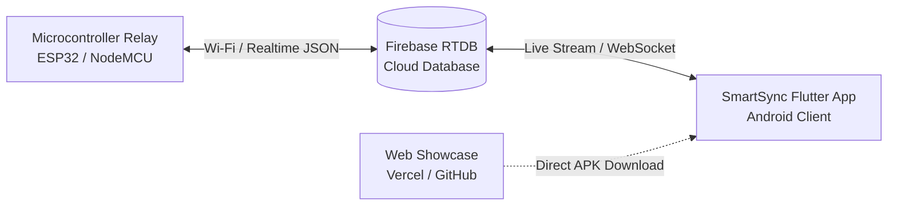

# SmartSync ⚡

> **Next-Generation IoT Smart Home Automation & Control Platform**  
> Connect custom microcontroller relays with a native Flutter mobile client through real-time Firebase cloud data pipelines.

---

## 📌 Overview

**SmartSync** provides a seamless, low-latency interface for smart home automation. Combining a high-performance **Flutter mobile client**, a **Firebase Realtime Database (RTDB)** backbone, and an interactive **Web Showcase**, SmartSync allows homeowners and engineers to monitor and toggle IoT devices (lighting, climate, smart plugs, security access) in sub-second real time.

---

## ✨ Key Highlights

- **⚡ Sub-Second Real-Time Sync**: Bi-directional device state updates powered by Firebase Realtime Database.
- **🎨 Modern Next.js & Shadcn Aesthetic**: Minimalist, card-based interface with high-contrast surfaces (`#FFFFFF` on `#F8FAFC` in light mode, `#111827` on `#090D16` in dark mode) and royal tech-blue accents (`#2563EB`).
- **📱 Fully Docked Bottom Navigation**: Clean zero-margin navigation bar featuring **Devices**, **Instructions**, and **Profile** views.
- **🔐 Complete Authentication Suite**: Email/Password, 2-step setup, Password Recovery, Deep Linking, and Google Sign-in.
- **📖 Hardware Guides & Schematics**: In-app wiring schematics, pinout references, and microcontroller flashing instructions.
- **🌐 Responsive Web Showcase**: Zero-dependency landing page with direct release APK downloads and interactive IoT architecture diagrams.

---

## 🏗️ Architecture

---

## 📚 Documentation & Developer Guide

All detailed setup guides, project structures, security rules, and ecosystem resources are maintained in **[DOCUMENT.md](DOCUMENT.md)**:

- 📂 **[Project Structure](DOCUMENT.md#-project-structure)**: Directory layout and module organization.
- 🚀 **[Getting Started](DOCUMENT.md#-getting-started)**: Prerequisites, cloning, Firebase configuration, and running the app.
- 📦 **[Building Release APK](DOCUMENT.md#5-build-the-release-apk)**: Instructions for compiling the Android binary.
- 🌐 **[Web Showcase Hosting](DOCUMENT.md#-web-showcase--landing-page)**: Running and deploying the landing page.
- 🔒 **[Security Best Practices](DOCUMENT.md#-security-best-practices)**: Safe credential handling and Firebase security rules.
- 🔗 **[Ecosystem & Related Projects](DOCUMENT.md#-ecosystem--related-projects)**: Connected platforms, telemetry portals, and cyber utilities.

---

## 👨‍💻 Author & Credits

- **Author**: [Venkata Krishna](https://github.com/krishna99-tech)
- **Ecosystem**: COE-IOT ECOSYSTEM

---

## 📄 License

This project is licensed under the [MIT License](LICENSE).
